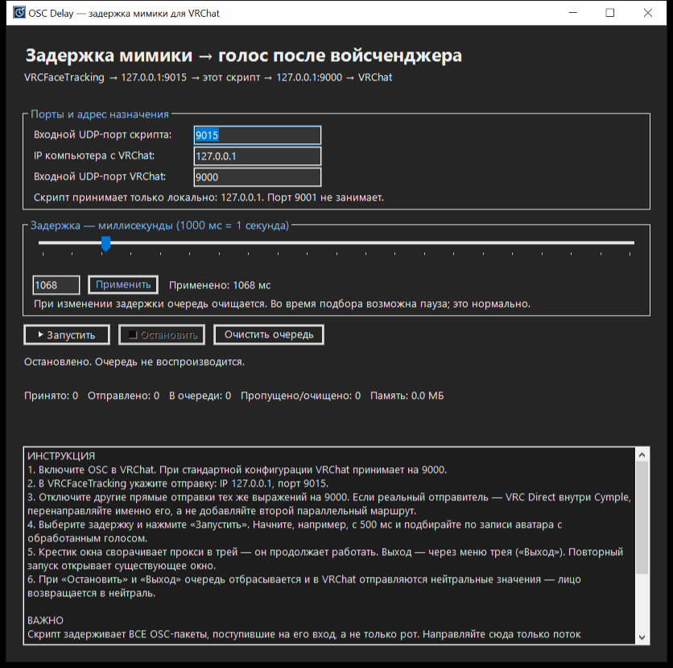

# OSC Delay — задержка мимики для VRChat

Один файл `OSC_Delay.exe`. Ничего устанавливать не нужно: работает на любой Windows 10/11.
Принимает OSC-пакеты фейстрекинга, задерживает их на выбранное время и отправляет в VRChat.

## Как выглядит



## Подключение (схема)

```text
VRCFaceTracking (или Cymple VRC Direct)
    отправляет на 127.0.0.1:9015
         ↓
OSC_Delay.exe  →  задержка N мс  →  127.0.0.1:9000  →  VRChat
```

1. В VRChat включите OSC (стандартный входной порт 9000).
2. В **реальном отправителе** (VRCFaceTracking / Cymple VRC Direct) укажите:
   IP `127.0.0.1`, порт `9015`.
3. Убедитесь, что больше никто не отправляет те же выражения прямо на 9000.
   Два параллельных отправителя = рот двигается дважды.
4. Дважды нажмите `OSC_Delay.exe`.
5. Выберите задержку, нажмите «▶ Запустить».
6. Проверьте счётчик «Принято» — он должен расти. «Отправлено» растёт с отставанием
   на выбранную задержку.

## Трей и выход

- **Крестик окна сворачивает прокси в трей; он продолжает работать.** Окно можно
  не держать открытым — сверните и играйте.
- **Выход — только через меню трея** (правый клик по иконке): «Показать»,
  «Очистить очередь», «Остановить», «Выход». «Выход» останавливает прокси и
  закрывает приложение.
- Двойной клик по иконке в трее — показать окно.
- Повторный запуск (`OSC_Delay.exe` второй раз) открывает существующее окно,
  вторая копия не создаётся.
- При первом сворачивании появляется подсказка-всплывающее сообщение.

## Запуск при каждом включении Windows

Создайте ярлык `OSC_Delay.exe` в папке `C:\Users\ВашИмя\AppData\Roaming\Microsoft\Windows\Start Menu\Programs\Startup`.

## Подбор задержки под войсченджер

- Начните с 500 мс. Запишите аватар вместе с обработанным голосом, который получает VRChat.
- Рот раньше звука на 600 мс → поставьте 600 и сравните запись снова.
- При изменении задержки очередь очищается — короткая пауза, это нормально.
- Для разных войсченджеров подбирайте отдельные значения (записывайте их).

## Ограничения

- Крестик сворачивает прокси в трей — он продолжает работать. При «Остановить» и
  «Выход» (меню трея) очередь отбрасывается и в VRChat отправляются нейтральные
  значения — лицо возвращается в нейтраль.
- Задерживаются ВСЕ пакеты, пришедшие на вход. Направляйте сюда только выражения лица;
  не голову, контроллеры, чат, служебные команды.
- Скрипт однонаправленный: обратные сообщения VRChat и OSCQuery-обнаружение
  работают штатным маршрутом отправителя, скрипт их не трогает.
- Точность задержки приблизительная (Windows, нагрузка, UDP).

## Диагностика

| Симптом | Что проверить |
|---|---|
| Принято = 0 | Отправитель шлёт на 9015? Автоматическое обнаружение не выбирает VRChat напрямую? |
| Принято растёт, рот не движется | OSC в VRChat включён? Порт 9000 верный? Каналы аватара? |
| Рот открывается дважды | Второй отправитель шлёт прямо на 9000 — отключите; конфликт Viseme со звуком |
| Порт занят | Закройте другой прокси, выберите свободный входной порт (и в отправителе) |
| Окно не открывается | Windows 10/11? Антивирус заблокировал exe? |
| Окно закрыто, поток не идёт | Окно свёрнуто в трей: двойной клик по иконке — показать; «Выход» из меню — остановить. Если прокси остановлен («Остановить»), поток не идёт — запустите снова |

Windows один раз спросит разрешение на сеть — разрешите: приложение принимает только
127.0.0.1 (локально), наружу ничего не открывает.

## Возврат к прямой схеме

Остановите скрипт и верните в отправителе порт 9000. Не оставляйте 9015,
если скрипт закрыт — выражения перестанут доходить.

Настройки хранятся в `%LOCALAPPDATA%\OSC_Delay_RU\settings.json`.
